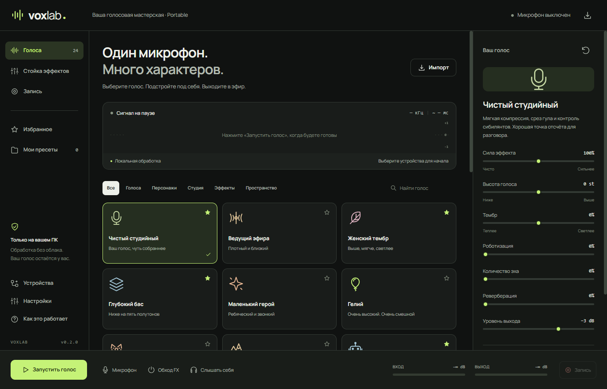

# VoxLab

Локальная голосовая мастерская для Windows: пресеты, обработка микрофона в реальном времени и запись WAV. Для общения, игр, стримов и творческих дублей.



## Запуск

1. Распакуйте **всю** папку `VoxLab-win-x64`.
2. Откройте `VoxLab.exe`. Это **portable**: установка приложения и отдельная установка .NET не нужны.
3. В разделе **Устройства** выберите микрофон и выход.
4. Выберите пресет и нажмите **Запустить голос**.

Windows 10/11 x64 и установленный **Microsoft Edge WebView2 Runtime**. WebView2 обычно уже есть в Windows; если он отсутствует, установите официальный Evergreen Runtime от Microsoft. Сборка пока не подписана сертификатом издателя. Администраторские права самому VoxLab не нужны.

В версии 0.1.1 основная папка выглядит так:

```text
VoxLab.exe          ← запуск приложения
Начни здесь.txt     ← короткая инструкция
App/               ← библиотеки, интерфейс, кабель и лицензии
Data/              ← настройки и записи; создаётся при запуске
```

При переходе с 0.1.0 распакуйте новую версию в отдельную папку и перенесите в неё свою `Data`. Весь комплект остаётся переносимым; перемещать один EXE отдельно от `App` нельзя.

**Для Discord, игр и других программ нужен виртуальный аудиокабель.** Оригинальный ZIP **VB-CABLE Basic** находится в `App/Drivers/VB-CABLE` внутри portable-пакета; кнопка в разделе «Устройства» открывает его расположение. Его драйвер один раз устанавливается отдельно с правами администратора: системный микрофон нельзя сделать переносимым одной папкой. VoxLab не запускает установщик автоматически. [Настройка маршрута](docs/ROUTING.md).

## Что внутри

- **16 пресетов:** чистый студийный, ведущий эфира, женский тембр, глубокий бас, маленький герой, гелий, клоун, великан, робот, андроид, пришелец, призрак, пещера, рация, мегафон и двойник.
- Высота **±12 полутонов**, изменение окраски, кольцевая модуляция, сатурация, радио, хор, эхо и реверберация.
- Нойзгейт с гистерезисом и удержанием; компрессор с мягким коленом, атакой, восстановлением и компенсацией; high-pass, трёхполосный EQ, деэссер и выходной лимитер.
- Свои пресеты, избранное, импорт/экспорт JSON и автоматическое сохранение настроек.
- WASAPI shared-mode, выбор входного канала, буферы 20/40/80 мс, отдельный выход для прослушивания и независимая его громкость.
- Индикаторы входа и выхода, живая форма сигнала, оценка задержки, загрузка DSP и счётчик прерываний.
- Запись обработанного сигнала в локальный **WAV 32-bit float mono**. Остановка движка корректно завершает файл.
- Системный трей, глобальные горячие клавиши, mute и обход эффектов.

Обработка происходит на CPU, без сети, учётной записи или нейросетевой модели. Микрофон не включается при запуске. Настройки, кеш интерфейса и начальная папка записей находятся в **`Data` рядом с EXE**. Переносите всю папку; при обновлении сохраните свою `Data`. Распакуйте приложение в доступную для записи папку, а не запускайте из ZIP. Закрытие окна останавливает звук; для работы в фоне используйте кнопку сворачивания в трей.

## Горячие клавиши

| Сочетание | Действие |
| --- | --- |
| Ctrl + Alt + M | Заглушить / вернуть микрофон |
| Ctrl + Alt + B | Обход обработки голоса |
| Ctrl + Alt + S | Запуск / остановка |
| Ctrl + Alt + 1…8 | Первые восемь пресетов библиотеки |

Отключаются в справке. Занятые сочетания отображаются там же.

## Честные ограничения

- «Женский» и «детский» — характерные DSP-пресеты. Они преобразуют исходный голос, а не заменяют его личностью другого диктора. Естественность зависит от вашего голоса; при больших сдвигах возможны артефакты.
- Параметр «Тембр» управляет спектральным наклоном EQ. Это **не** независимый формантный процессор.
- Гейт закрывает фон в паузах. Нейросетевого шумоподавления и подавления акустической обратной связи в этой версии нет.
- Задержка на экране — оценка буферов и алгоритма, не измеренный round-trip. Конкретные устройства, драйвер и сторонний чат добавляют свою задержку.
- Наушники рекомендуются: вывод микрофона на колонки может вызвать свист. Нужен ручной старт, а обычные динамики не выбираются автоматически.
- Собственного виртуального драйвера, VST-хостинга, ASIO и AI-моделей нет. Прилагается самостоятельный пакет VB-CABLE; его лицензия и жизненный цикл отдельны от VoxLab.
- Протестированы математические свойства DSP и локальный WASAPI-поток. Это не заменяет субъективную оценку каждого голоса и проверку всех моделей устройств. [Отчёт о проверке](docs/VALIDATION.md).

## Сборка из исходников

Нужны Windows x64 и .NET 10 SDK. Все версии NuGet закреплены; lock-файлы входят в репозиторий.

```powershell
./build.ps1 -Test -Publish
```

Готовая папка: `artifacts/VoxLab-win-x64`; пользователь запускает её корневой `VoxLab.exe`. Штатный native apphost .NET загружает `App/VoxLab.dll` и runtime из `App`, без дополнительного процесса и распаковки при запуске. WebView2 Runtime устанавливается отдельно от SDK. Не удаляйте DLL, `Web`, `runtimes` и лицензии из `App`. Не включайте single-file / trimming: SoundTouch.Net должен оставаться заменяемой библиотекой.

Отдельно проверить ядро:

```powershell
dotnet run --project tests/VoxLab.Tests -c Release
```

Посмотреть интерфейс без Windows-аудио:

```powershell
python -m http.server 8765 --bind 127.0.0.1 --directory src/VoxLab.App/Web
```

Этот режим явно помечен как предпросмотр; звук работает только в `.exe`.

## Архитектура и источники

[Архитектура](docs/ARCHITECTURE.md) · [GitHub-исследование](docs/RESEARCH.md) · [Маршрутизация](docs/ROUTING.md) · [Лицензии зависимостей](THIRD-PARTY-NOTICES.md).

Собственный код: MIT. SoundTouch.Net: LGPL-2.1-or-later, отдельная DLL с исходниками в поставке. Интерфейс и цепочка эффектов реализованы для VoxLab; код рассмотренных voice-changer-проектов не копировался.

VB-CABLE — продукт VB-Audio / Vincent Burel, **Donationware**; добровольная поддержка автора приветствуется. Источник: [www.vb-cable.com](https://www.vb-cable.com). Архив распространяется без изменений, на собственных условиях издателя.
